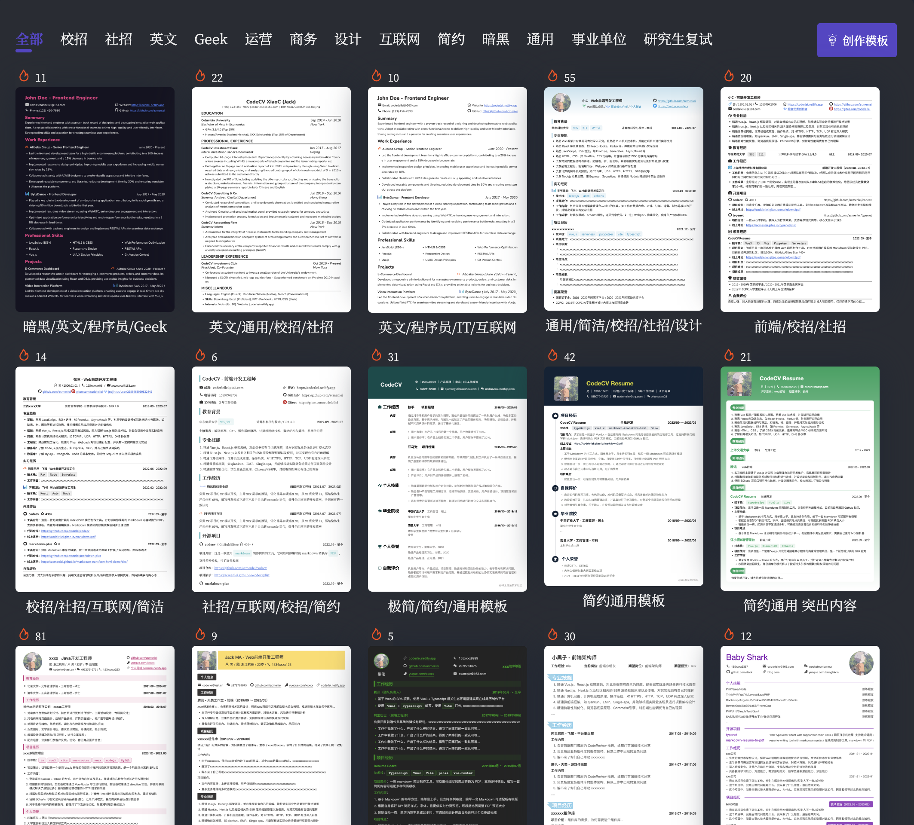
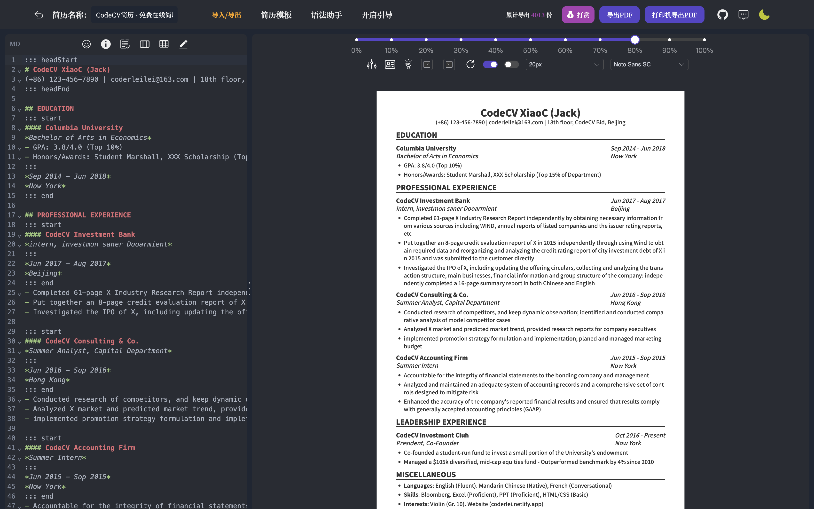
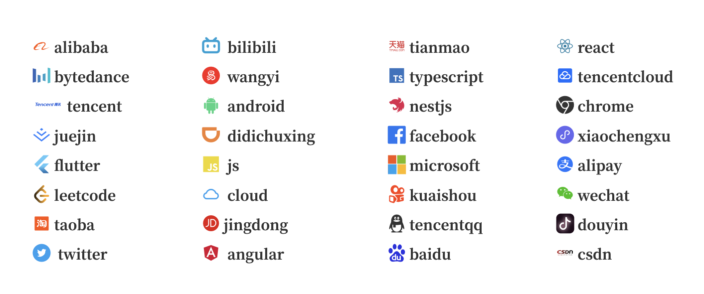

# codecv-Enhanced

这是一款基于 Markdown 语法的在线简历制作工具，它可以将你编写的 `markdown` 简历转为 `PDF`，同时提供海量模板。

<div style="font-size: 1.5rem;">
  <a href="./README.md">中文</a> |
  <a href="./README.en.md">English</a>
</div>
</br>

Fork from: https://github.com/acmenlei/codecv .

## Docker 快速部署

你可以直接使用我已经构建好的镜像来运行

```sh
docker run -d -t -p 8080:80 --name codecv --restart=always docker.io/wenyang0/codecv:latest
```

或者，如果您愿意，也可以自己手动编译。

```sh
#下载代码
git clone https://github.com/acmenlei/codecv.git

#docker 编译
cd codecv/
docker build -t codecv:v1 .

#启动服务
docker run -d -t -p 8080:80 --name codecv --restart=always codecv:v1
```

最后,打开你的浏览器访问服务的地址 http://serverIP:8080 即可（模板请自行编写与设计）


## 本地安装调试

```shell
# 安装yarn包(有一个包需要使用yarn命令才能安装)
npm i -g yarn

#安装包
yarn install

#执行yarn install如果报错： yarn:无法加载文件 C\Users\talen\...\yarn.ps1
#	打开Power Shell
# 执行 set-ExecutionPolicy RemoteSigned 
set-ExecutionPolicy RemoteSigned 	
#选择 A或者Y 解除脚本不信任 重新执行 yarn install

#启动项目
npm run dev  或 yarn run dev
```

## 效果预览

<p>简历模板</p>



<p>简历编辑和暗黑主题</p>



<p>内置多种矢量图标</p>



## ChangeLOG

|    DATE    | VERSION |                    LOG                     |
| :--------: | :-----: | :----------------------------------------: |
| 2026.10.16 | v1.1.2  | 新增 gridLayout 语法，支持容器中部元素对齐 |
| 2026.10.16 | v1.1.1  |          修复了原工具无法正常导出          |


## License

MIT © [Coderlei](./license)
